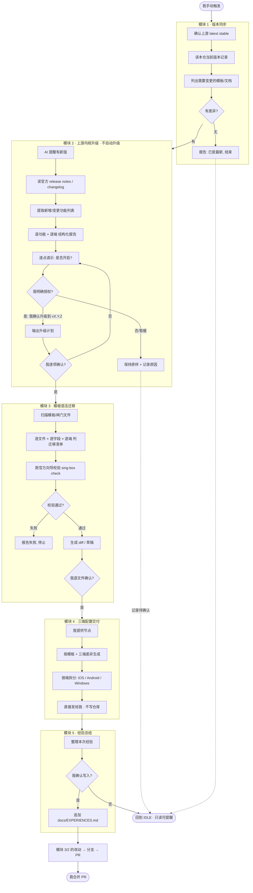

# AI_SYNC_WORKFLOW.md — AI 驱动的 sing-box 配置同步工作流

> **一句话定义**：由我手动触发、由 AI Agent 执行的一套「读仓库 → 比上游 → 报告 → 我逐点拍板 → 落文件 → 出分支 PR」的
> sing-box 配置同步流程。Agent（本仓库的执行方）默认**只读 + 可提醒 + 可生成草稿**；任何写仓库的动作都要我点头。

> ⚠️ **唯一权威来源**：关于 sing-box 的功能、语法、平台支持、版本变更，唯一权威来源是
> sing-box 上游官方仓库的文档、release notes、changelog ——
> **上游项目：sing-box 官方仓库 `https://github.com/SagerNet/sing-box`，
> 官方文档 `https://sing-box.sagernet.org/`。**
> **本仓库的文档/模板/经验总结只用于工作流定义与经验参考，不具备权威性。**
> 不得依据本仓库旧模板反推上游行为，不得编造上游功能、版本号、配置项、语法或平台支持。
> 找不到官方依据时，标注「未能确认」或「待人工判断」，不要猜。

---

## 零bis. 这套仓库要解决什么问题

sing-box 迭代快，字段会**改名、合并、废弃、移除**，而且：

- 未知字段 → `FATAL ... json: unknown field` → 配置起不来
- 已移除字段 → `FATAL ... deprecated in X and removed in Y` → 配置起不来
- **已废弃但未移除** → 很多字段 `sing-box check` **完全静默**（典型：`download_detour`）
- **平台差异** → `check` 完全不校验（iOS 写 `strict_route` 照样 exit=0，但没效果）

所以**只靠「让 Agent 背文档」必然出错**。本仓库把这些知识**固化成可执行的检查**：

| 风险 | 兜底手段 |
|---|---|
| 未知字段 / 已移除字段 | `sing-box check`（内核自己报） |
| 已废弃未移除字段 | `docs/version-matrix.json` + `tools/audit.py` |
| 平台能力差异 | `docs/PLATFORM-MATRIX.md` + `tools/audit.py` |
| 引用完整性（出站/规则集/DNS server 不存在） | `tools/audit.py`（`check` **不校验**！） |
| 规则集**顺序**（放行/拦截/分流先后错了等于没加） | `tools/audit.py` 的 Jinx 顺序检查 |
| **tun 出口回灌**（能启动但没网，`check` 全静默） | `tun_without_auto_detect_interface` 门禁 |
| **新增能力没决策**（多了什么而不是少了什么） | `tools/upgrade-check.py` 第 5 节 + 矩阵 `kind="new"` + `DECISIONS.md` |
| **真实节点地址泄到公开仓库**（`docs/` 散文也会公开） | `sensitive_ip_in_repo`（扫被跟踪文件 + commit message） |
| **门禁自己坏了 / 静默跳过**（工具语法错也能全绿） | `tool_syntax_error` + `tool_selftest_failed` |
| **模板里的文字过期**（`_rules_of_thumb` 无人消费，最易写反） | `template_thumb_stale` |
| 上游又改了 | `tools/upgrade-check.py` |

**目录职责**

```
singbox_version.txt        当前锁定的正式版（唯一真相）
AGENTS.md                  指路牌 + 硬规则入口
AI-ENTRY.md                机器入口卡片（面向 LLM）
MAINTAINERS.md             改规则的操作手册
docs/AI_SYNC_WORKFLOW.md   本文件：总工作流
docs/PROTOCOL-MAPPING.md   分享链接 → outbound 字段映射（核心知识）
docs/PLATFORM-MATRIX.md    三平台能力差异
docs/version-matrix.json   机器可读字段生命周期（audit.py 的依据）
docs/VERSION-MATRIX.md     上表的人读版（由 tools/gen-docs.py 生成，勿手改）
docs/schema.json           sing-box 官方 schema（字段白名单）
docs/upstream-*.md         上游文档快照（取上游 testing 分支，可能比锁定版本新）
docs/evidence/             事故证据存档（脱敏后入库）
profiles/<大版本>/          可运行配置（**占位节点**），按平台分文件
templates/                 片段骨架（分流组）+ 三端索引入口
  groups.json              三个固定分流组的结构
  ios/ android/ windows/   三端索引入口（每个目录一份 README，**不含可运行配置**）
nodes/nodes.example.json   节点书写示例
tools/                     门禁与工具（各工具 --help 自带说明）
local/                     【不提交】真实节点配置与私有状态
archive/<大版本>/          旧版本配置归档（只归档不删除）
```

---

## 一、角色与职责

| 角色 | 职责 | 边界 |
|---|---|---|
| **我（老板）** | 手动触发、逐项授权、最终合并 | 唯一有权说「升级」「开启」「迁移」的人 |
| **AI Agent** | 读取、比对、报告、生成草稿、落文件、开 PR | **不得**自动升级 / 自动开启新功能 / 自动迁移语法 / 自动改版本记录 |
| **sing-box 上游项目** | 唯一权威来源 | 只跟 **latest stable**；beta/alpha/rc/nightly/pre-release 一律不跟 |
| **本仓库（GitHub）** | 工作流定义 + 模板维护 + 经验总结 | 只存模板，**不存节点、不存可运行配置**（见 §九 现状说明） |
| **三端客户端**（iOS / Android / Windows） | 配置的消费方 | 三端能力有差异，**以 sing-box 上游官方文档为准**，不凭经验猜 |

---

## 二、工作流总览



**模块 2 状态机**

```
IDLE（只读可提醒）
  → Agent 提醒有新版
  → 我问详情
  → Agent 报告
  → 我授权升级（口令）
  → Agent 输出计划
  → 我逐项确认
  → Agent 修改
  → 校验
  → 分支 / PR
  → 我合并
```

---

## 三、触发条件与准入规则

**只有我手动触发，AI 才开始行动。** 不允许自动定时同步。

| 触发方式 | 允许的做法 |
|---|---|
| 我主动说「检查 sing-box 上游最新稳定版」 | AI 进入**只读报告**状态 |
| AI 发现上游有新 stable（心跳/我提问时顺带看到） | AI **可以提醒**我，然后停下等我 |
| 任何定时任务 | ❌ 不得触发同步。仓库现有的 `.github/workflows/audit.yml` 是**质量门禁**（跑 `audit.py`），**不是**上游同步，两者无关 |

**准入规则**

- 只跟 sing-box 上游 **latest stable**。
- 禁止跟：`beta`、`alpha`、`rc`、`release candidate`、`nightly`、`pre-release`、`测试版`、`预览版`。
- 每次只处理我**点名**的版本、功能、端或文件。未点名的一律不动。
- 未确认项保持原样，并记录为「待确认」。

---

## 四、五个模块

> 详细展开见对应文档：
> 模块 2 → [`SINGBOX_UPGRADE.md`](SINGBOX_UPGRADE.md)　模块 3 → [`TEMPLATE_MIGRATION.md`](TEMPLATE_MIGRATION.md)
> 模块 4 → [`CLIENTS_IOS_ANDROID_WINDOWS.md`](CLIENTS_IOS_ANDROID_WINDOWS.md)　模块 5 → [`EXPERIENCES.md`](EXPERIENCES.md)

### 模块 1：版本同步

**输入 → 动作 → 输出 → 人工确认点 → 失败处理**

| 步骤 | 输入 | Agent 动作 | 输出 | 人工确认点 | 失败处理 |
|---|---|---|---|---|---|
| 1.1 确认上游版本 | 我的触发指令 | 查 sing-box 上游 latest **stable** 标签 | 版本号 + 官方来源链接 | — | 上游无 stable release → 报告并停止（见 §十 异常处理） |
| 1.2 读本仓记录 | `singbox_version.txt` | 读取当前锁定版本 | 当前版本号 | — | 文件缺失 → 报告，**不猜**当前版本 |
| 1.3 比对 | 两者 | 列出差异 | 差异表 | — | 版本号格式无法解析 → 标「待人工判断」 |
| 1.4 定影响面 | 差异 | 列出需变更的模板/文档 | 影响清单 | ✅ **我确认影响面** | 找不到依据 → 标「未能确认」 |
| 1.5 报告 | — | 输出报告并停止 | 报告 | ✅ | — |

**版本识别细则**

- **上游 latest stable**：以 sing-box 官方仓库的 release 为准；排除所有 pre-release 形态的标签。
- **本仓当前版本**：`singbox_version.txt`（**唯一版本真相**）。改它属于「需我同意的六个动作」之一（见 `AGENTS.md` 铁律 17）。
- **需要变更的模板/文档**：由 `python tools/upgrade-check.py` 的报告给出（第 3/4/5 节）。

---

### 模块 2：上游内核版本升级流程（可提醒，不自动升级）

> **本模块的「不得自动升级」只约束本模块。** 它不限制模块 1/3/4/5 的正常工作。

**本模块的完整规则**（AI 可以做的事 10 条 / 绝对不得做的事 6 条 / 升级授权口令 /
状态机）→ [`SINGBOX_UPGRADE.md`](SINGBOX_UPGRADE.md)。

本文件只保留**一句话**与**状态机**：

> AI 可以**提醒**、可以**报告**、可以**问我要不要更新**；
> **没有我的授权口令，不得进入升级流程**。

```
IDLE（只读可提醒） → 提醒有新版 → 我问详情 → 报告 → 我授权 → 出计划 → 我逐项确认 → 修改 → 校验 → PR → 我合并
```

> **单一来源原则**：本模块的规则清单此前在 `AI_SYNC_WORKFLOW.md` 与
> `SINGBOX_UPGRADE.md` 各写了一遍（一字不差）—— 典型的「两处定义漂移」隐患。
> 现收敛到详版（`SINGBOX_UPGRADE.md`），本文件只留摘要与指针。

---

### 模块 3：模板/闸门文件语法迁移（必须经我确认）

> 「闸门文件/模板文件」= 仓库中依赖 sing-box 版本语法的配置模板、规则模板、平台模板。

1. 扫描仓库所有模板/闸门文件，识别哪些字段/结构是**版本相关**的。
2. 对每个受影响文件，**按 iOS / Android / Windows 分别处理**：
   - 当前使用的语法/字段
   - 该语法在目标版本是否仍有效（deprecated / removed / renamed / 行为变更）
   - **官方**迁移说明或 changelog 依据
   - 迁移建议（改成什么、影响范围、是否可自动迁移）
   - 三端是否都受影响
3. 输出「模板/闸门文件迁移清单」，**逐文件、逐字段、逐端**。
4. **迁移必须经我确认**：不得自动批量替换。可以先生成 diff 或草稿，**不得直接覆盖可用模板**。
5. 迁移前必须跑 sing-box 官方校验（`sing-box check` / `sing-box format`，或仓库的 `tools/check-all.sh`），失败要报告。
6. 无法确定是否兼容的语法，标「待人工判断」，**不要强行改**。
7. 迁移完成后更新版本记录文件，并写 changelog。

---

### 模块 4：三端配置交付（模板 vs 实际配置）

- 仓库中**只保留模板**。
- 我提供节点信息后，AI 根据模板和三端差异生成可运行配置。
- **生成的实际配置直接发给我** —— 不得写入仓库、不得提交、不得持久化节点。
- 必须按端区分：iOS / Android / Windows。
- 三端差异**必须依据上游官方文档**，不得凭经验猜。

**交付格式见 §八。**

---

### 模块 5：经验总结

- 落到 [`docs/EXPERIENCES.md`](EXPERIENCES.md)。
- 记录：三端差异 / 语法迁移经验 / 新功能适配经验 / 常见错误与修复 / 校验命令 / 客户端限制 /
  哪些功能在哪些端不可用 / **因浅克隆导致的问题与修复**。
- 每次升级确认后，AI **可以建议**追加经验，但**需我确认后才写入**。
- 经验总结仅供参考，**不替代上游官方文档**。

---

## 五、三端差异处理原则

- 三端（iOS / Android / Windows）能力不同，**以 sing-box 上游官方文档为准**。
- 已有对照表见 [`PLATFORM-MATRIX.md`](PLATFORM-MATRIX.md)（本仓维护），交付细则见
  [`CLIENTS_IOS_ANDROID_WINDOWS.md`](CLIENTS_IOS_ANDROID_WINDOWS.md)。
- 对每个功能，三端分别标注：**可用 / 不适用 / 需客户端支持 / 不确定**。
- 判断依据必须写出（如需要 TUN、需要特定协议、需要客户端 UI 支持、仅服务端、仅移动端、平台限制）。
- 上游文档没写明某端行为时，标「不确定」，**不要由另外两端的结论推断第三端**。

---

## 六、唯一权威来源原则

关于 sing-box 的一切技术事实，**唯一权威来源是上游官方**：

1. 官方仓库文档（`docs/configuration/`、`docs/clients/{apple,android,desktop}/`）
2. 官方 release notes / changelog
3. 官方源码与官方客户端源码

**优先级：官方文档 > 官方源码 > 本仓文档。**

- 冲突时以官方为准，并**当场修本仓文档**，不留「以本仓结论为准」的余地。
- 本仓的每一条经验结论都必须能追到官方来源；追不到的**写成「未验证」，不写成结论**。
- ⚠️ 本仓 `docs/upstream-*.md` 是**上游 testing 分支的快照**，可能比锁定版本更新。
  用它判断「当前锁定版本支持什么」是**错的**；它的用途是「提前预警下个版本要改什么」。
- 不得依据本仓旧模板反推上游行为。

---

## 七、完整克隆规则（最高优先级）

**每次换设备、换 AI Agent/助手、换运行环境后，在修改本仓库前，必须完整克隆（full clone）。**

- ❌ **严禁浅克隆**。禁止 `--depth=1`、`--depth=<任何数值>`、`--filter=blob:none`、`--filter=tree:0`
  等任何会丢失历史信息的克隆方式。
- 浅克隆会丢失提交历史、标签、分支、远端引用、版本记录，导致**版本对比、上游差异分析、
  模板语法迁移判断出错或直接报错**。

**如果当前工作区已经是浅克隆，必须先修复：**

```bash
git rev-parse --is-shallow-repository     # 返回 true 就是浅克隆
git fetch --unshallow                     # 修复；或直接删除后重新完整克隆
```

**完整克隆后必须确认：**

```bash
git rev-parse --is-shallow-repository      # 必须返回 false
git rev-list --count HEAD                  # 能读出完整提交历史
git tag | wc -l                            # 能读出标签
git branch -a                              # 能读出所有相关分支
```

- 如果 AI 环境**无法持久化仓库**，每次操作前都应重新完整克隆，不得依赖缓存或浅克隆。
- 如果 AI **无法直接克隆**（例如无网络权限），必须**明确告诉我**，并指导我在本地完整克隆后提供仓库，
  或提供完整仓库压缩包 —— **不得在浅克隆基础上继续操作**。

> 📌 **实战记录**：本工作流建立过程中，AI 曾用 `gh repo clone ... -- --depth 1` 克隆，
> 结果 `git rev-list --count HEAD` 只有 1 个提交、0 个标签，无法做版本对比。
> 修复命令：`git fetch --unshallow` → 提交数恢复到 33。详见 `EXPERIENCES.md`。

---

## 八、文档分层原则

- **`AGENTS.md` 只作为指路牌 + 硬规则入口**，不承载详细技术内容。
- `AGENTS.md` 的内容上限：项目定位 / 必读顺序 / 硬规则清单 / 文档索引 / 禁止事项 / 回复格式 / 完整克隆要求。
- 详细技术内容下沉到 `docs/` 分类文档。
- `AGENTS.md` 中每条硬规则可以有一句话说明，**详细解释必须链接到对应 docs**。
- **禁止**把长篇技术说明、语法对照表、历史 changelog 直接堆进 `AGENTS.md`。

---

## 九、分支、提交、PR 规范

- **不得直接推 `main`/`master`**，必须**分支 + PR**。
- 本次工作的分支名：`docs/ai-sync-workflow`（按任务约定）。
- 每次升级/迁移用独立分支，命名建议：`sync/singbox-vX.Y.Z`、`migration/<主题>`。
- **不得自动合并 PR**。合并权只在我。
- 提交信息模板：

  ```
  docs: reorganize AI-driven sing-box sync workflow and agent guide
  ```

- PR 描述必须包含：新增文档 / 扩展文档 / 合并文档 / 删除文档及理由 / 重命名及理由 /
  复用情况 / 待确认信息 / 验证结果 / 风险 / **克隆方式确认**。
- 任何写入仓库、修改模板、更新版本记录、创建 PR 的操作，都**必须经我确认**。

---

## 十、聊天指令模板

| 我要干什么 | 我该说的话 |
|---|---|
| 只要检查 | `检查 sing-box 上游最新稳定版，只列出新增功能、三端适用性、模板语法影响。不要改任何文件，不要升级。` |
| 授权升级 | `我确认升级到 sing-box vX.Y.Z。先给我升级计划，不要直接改。` |
| 逐项确认功能 | `功能 1 在 iOS 开启；功能 2 在 Android 不开启；功能 3 在 Windows 暂缓。` |
| 授权模板迁移 | `我确认对以下模板文件做语法迁移：{{文件列表}}。先给 diff，不要覆盖可用模板。` |
| 执行升级 | `按以上确认执行，创建分支和 PR。` |
| 只要配置 | `根据我提供的节点，生成 iOS / Android / Windows 可用配置，直接发给我，不要写入仓库。` |
| 换设备后首次操作 | `先完整克隆仓库，确认不是浅克隆，然后盘点现有文档结构，再等我指令。` |
| 基于现有改 | `先盘点现有仓库结构和文档，说明哪些复用、哪些扩展、哪些合并、哪些新建、哪些拟删除、哪些拟重命名，不要推倒重建。` |

---

## 十一、配置文件交付格式

生成实际配置后，**按端分别交付**，每条包含：

```
适用端：        iOS / Android / Windows（明确哪一端）
基于版本：      sing-box <稳定版号>
模板来源：      profiles/<大版本>/<平台>-lazy.json（或说明手工来源）
变更点：        <相对模板改了什么、为什么>
完整可粘贴配置： <完整 JSON，不是 diff、不是片段>
校验命令与结果： <命令 + 结果>
风险与待确认项： <未验证项、平台差异、待人工判断>
```

- 配置**直接发给我**，不写仓库。
- 不得声称「已实测联网可用」——除非真在目标端跑过。
- 涉及真实节点的产物**不得进入 git**。

---

## 十二、禁止事项与红线

- ❌ 自动升级 sing-box 版本（模块 2）
- ❌ 自动启用任何新功能
- ❌ 未经授权迁移模板语法
- ❌ 未经授权更新版本记录文件
- ❌ 未经授权创建 PR / 合并 PR
- ❌ 直接推 `main`/`master`
- ❌ 浅克隆后继续操作
- ❌ 编造上游功能、版本号、配置项、语法、平台支持
- ❌ 依据本仓旧模板反推上游行为
- ❌ 把真实节点、可运行配置、secrets 写入仓库
- ❌ 删除我未确认移除的现有内容/模板
- ❌ 运行会改变上游或生产配置的命令

---

## 十三、异常处理

| 异常 | 处理 |
|---|---|
| **上游无 stable** | 报告「当前无可用 stable release」，停止，不做任何推断 |
| **版本识别不清** | 标「待人工判断」，列出手上所有版本线索，**不猜** |
| **配置冲突** | 停止，列出冲突双方与各自依据，请我裁决 |
| **语法迁移不确定** | 标「待人工判断」，保持原样，不强行改 |
| **校验失败** | 报告完整错误输出与出错文件/字段，停止，**不得带病提交** |
| **找不到官方依据** | 标「未能确认」，不写结论 |
| **是浅克隆** | 先 `git fetch --unshallow` 修复；无法修复则停下并告知我 |
| **无权限推送** | 输出完整 patch/diff 和文件内容，让我手工应用 |

---

## 十四、待补充信息清单

本工作流基于任务描述撰写，以下条目在仓库中**未找到对应信息**，按约定标注为待确认：

- ✅ **上游项目 URL/名称** —— 已确认：sing-box 官方仓库 `https://github.com/SagerNet/sing-box`，
  官方文档 `https://sing-box.sagernet.org/`。
- ✅ **模板目录** —— 已确认双轨制：可运行模板在 `profiles/<大版本>/{desktop,android,ios}-lazy.json`；
  `templates/{ios,android,windows}/` 已建立，作为**三端索引入口**（各含一份 README，不含可运行配置）。
  详见 [`../templates/README.md`](../templates/README.md)。
- ✅ **当前同步版本记录文件路径** —— 已确认：`singbox_version.txt`（本仓既有的唯一版本真相）。
- ✅ **「仓库中只保留模板，不保存实际节点，不保存可运行配置」** —— **经确认按本仓现状保留**：
  「不保存**实际节点**、不保存**可运行配置的实例**」= 严格成立（真实节点只进 `local/`，已 gitignore）；
  但 `profiles/<大版本>/` 下**保留三份占位骨架**（`node-0X.example.com`，无任何真实凭据）——
  它们是三端模板的实现本体，也是门禁对账基准（`placeholder_server` / `matrix_platform_stale`）。
  删掉它们会让全部门禁失去比对对象，**不是本次目标**。
- ✅ **三端模板目录** —— 已建立 `templates/{ios,android,windows}/`，定位为索引入口（见上）。
